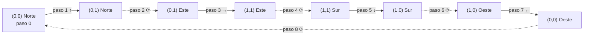
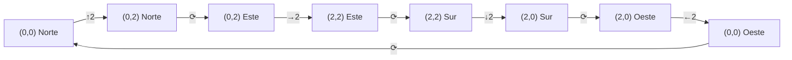
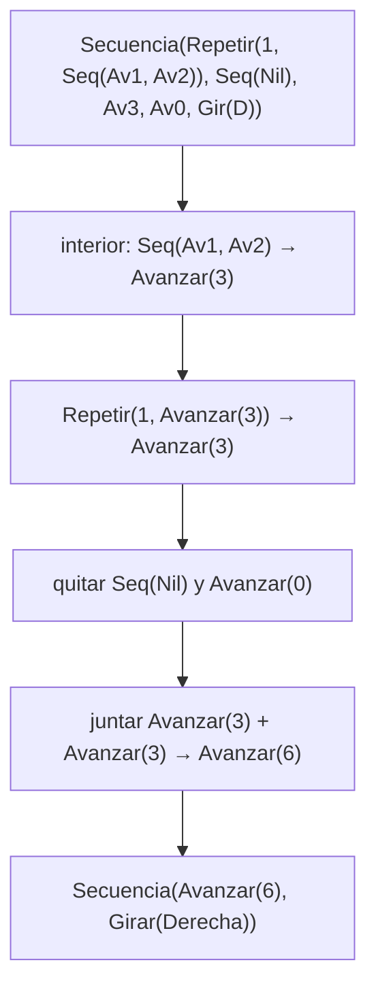

# Informe de proceso — Un robot en la cuadrícula

Fundamentos de Programación Funcional y Concurrente

El robot ocupa una celda $(x, y)$ de una cuadrícula infinita y mira hacia un punto
cardinal. Empieza en el origen mirando al norte: `inicial = Estado(0, 0, Norte)`.
Avanzar hacia el norte aumenta $y$, hacia el este aumenta $x$; avanzar con $n$
negativo retrocede.

Todas las funciones se escriben con `match` sobre las alternativas de `Orden`, sin
variables mutables ni ciclos. La recursión sigue la forma del tipo: `Repetir` y
`Secuencia` contienen otras órdenes, así que las funciones que las recorren son
recursivas. Las trazas que siguen se obtuvieron ejecutando el código del proyecto.

## Punto 1: `girar`

`girar(d, s)` hace `match` sobre la pareja `(d, s)` y devuelve el siguiente punto
cardinal en el sentido pedido: girar a la derecha recorre Norte → Este → Sur → Oeste,
y a la izquierda al revés.

```scala
case (Norte, Derecha) => Este
case (Este,  Derecha) => Sur
...
```
## Punto 2: `ejecutar`

Hay un caso por cada orden:

1. `Avanzar(n)` suma o resta $n$ a `x` o a `y` según `e.mira`, con `e.copy`.
2. `Girar(s)` cambia solo la dirección, mediante `girar(e.mira, s)`.
3. `Repetir(veces, o)` con `veces <= 0` deja `e` igual; si no, ejecuta `o` una vez
   y vuelve a llamarse con `veces - 1`.
4. `Secuencia(os)` aplica `foldLeft`: parte de `e` y ejecuta cada orden en orden.

### Traza: el cuadrado

Orden: `cuadrado = Repetir(4, Secuencia(List(Avanzar(1), Girar(Derecha))))`,
desde `inicial`.

| Paso | Orden que se ejecuta | Estado resultante |
|---|---|---|
| 0 | — | `(0, 0, Norte)` |
| 1 | `Avanzar(1)` | `(0, 1, Norte)` |
| 2 | `Girar(Derecha)` | `(0, 1, Este)` |
| 3 | `Avanzar(1)` | `(1, 1, Este)` |
| 4 | `Girar(Derecha)` | `(1, 1, Sur)` |
| 5 | `Avanzar(1)` | `(1, 0, Sur)` |
| 6 | `Girar(Derecha)` | `(1, 0, Oeste)` |
| 7 | `Avanzar(1)` | `(0, 0, Oeste)` |
| 8 | `Girar(Derecha)` | `(0, 0, Norte)` |

La orden que queda por ejecutar se va acortando: al inicio de cada vuelta es
`Repetir(k, secuencia)` con $k = 4, 3, 2, 1$; al final del paso 8 se llega a
`Repetir(0, ...)`, que es el caso base y devuelve el estado sin tocarlo. El robot
vuelve al origen mirando al norte.

Recorrido en la cuadrícula (cada flecha es un avance; el número es el paso):



### Traza: una L

Orden:
`Secuencia(List(Avanzar(2), Girar(Derecha), Avanzar(1), Girar(Derecha), Avanzar(3)))`.

| Paso | Orden | Estado |
|---|---|---|
| 0 | — | `(0, 0, Norte)` |
| 1 | `Avanzar(2)` | `(0, 2, Norte)` |
| 2 | `Girar(Derecha)` | `(0, 2, Este)` |
| 3 | `Avanzar(1)` | `(1, 2, Este)` |
| 4 | `Girar(Derecha)` | `(1, 2, Sur)` |
| 5 | `Avanzar(3)` | `(1, -1, Sur)` |

El `foldLeft` empieza en `(0, 0, Norte)` y le pasa a cada orden el estado que
dejó la anterior; el resultado es `Estado(1, -1, Sur)`.

### Repeticiones anidadas

`Repetir(2, Repetir(2, Secuencia(List(Avanzar(2), Girar(Derecha)))))` ejecuta el
avance de dos casillas y el giro cuatro veces, siempre en casillas distintas, y
termina en `Estado(0, 0, Norte)`:



## Punto 3: `cuantasBasicas` y `profundidad`

`cuantasBasicas` cuenta sin mover al robot: una básica vale 1, una `Secuencia`
suma las de sus hijas (`map` y `sum`) y un `Repetir(v, o)` multiplica por $v$.
`profundidad` vale 1 en las básicas; en `Repetir` es $1 +$ la de su orden y en
`Secuencia` es $1 +$ el máximo de las suyas (`foldLeft` con `math.max`).

Para el cuadrado se llega a `8` así: la secuencia interna vale $1 + 1 = 2$ y la
repetición multiplica por 4, dando `8`. La profundidad es $1$ (el cuadrado
contiene una `Secuencia`, que contiene básicas). Ninguna de las dos ejecuta la
orden, entonces no hay trazas de posiciones.

## Punto 4: órdenes y funciones de alto orden

- `componer(o1, o2)` devuelve `Secuencia(List(o1, o2))`.
- `rutina(pasos)(giro)(veces)` está currificada: `rutina(2)(Izquierda)` ya es una
  función que espera las veces. Produce
  `Repetir(veces, Secuencia(List(Avanzar(pasos), Girar(giro))))`; con `4` da
  `Repetir(4, Secuencia(List(Avanzar(2), Girar(Izquierda))))`.
- `aplicarA` hace `map` de `ejecutar(e, o)` sobre la lista de estados.
- `transformar` recorre la orden y aplica `f` solo a las básicas, reconstruyendo
  `Repetir` y `Secuencia` con las hijas transformadas.

`transformar(cuadrado, { case Avanzar(n) => Avanzar(2 * n); case otra => otra })`
devuelve `Repetir(4, Secuencia(List(Avanzar(2), Girar(Derecha))))`: el avance
pasa de 1 a 2 y los giros quedan igual. `aplicarA(List(inicial, Estado(5, 5, Sur)), Avanzar(2))`
da `List(Estado(0, 2, Norte), Estado(5, 3, Sur))`: cada estado avanza en la
dirección en que miraba.

## Punto 5: `simplificar`

La función aplica las reglas del enunciado de forma recursiva: simplifica el
interior de cada compuesta y vuelve a mirar el resultado. Así, una orden que
necesita varias pasadas se reduce en un solo recorrido, porque las reglas se
encadenan de dentro hacia afuera: lo que produce una regla en el interior es lo
que la siguiente regla encuentra al subir.

Traza con
`s = Secuencia(List(Repetir(1, Secuencia(List(Avanzar(1), Avanzar(2)))), Secuencia(Nil), Avanzar(3), Avanzar(0), Girar(Derecha)))`.
Se muestra el paso de la orden y la regla aplicada:

| Paso | Orden en ese momento | Regla |
|---|---|---|
| 0 | `Secuencia(List(Repetir(1, Seq(Av1, Av2)), Seq(Nil), Av3, Av0, Gir(D)))` | — |
| 1 | `Seq(Avanzar(1), Avanzar(2))` en el interior | 2: se juntan en `Avanzar(3)` |
| 2 | `Repetir(1, Avanzar(3))` | 3: `Repetir(1, o)` es `o` |
| 3 | `Secuencia(Nil)` | 5: no hace nada y se quita |
| 4 | `Secuencia(List(Avanzar(3), Avanzar(3), Avanzar(0), Girar(Derecha)))` | 2: se juntan en `Avanzar(6)` |
| 5 | `Secuencia(List(Avanzar(6), Avanzar(0), Girar(Derecha)))` | 1/5: `Avanzar(0)` se quita |
| 6 | `Secuencia(List(Avanzar(6), Girar(Derecha)))` | final: más de un elemento, se queda |

Resultado: `Secuencia(List(Avanzar(6), Girar(Derecha)))`. La orden original y la
simplificada ejecutan el mismo resultado: ambas dejan `Estado(0, 6, Este)`.

Otro caso que necesita más de una pasada:
`Repetir(2, Secuencia(List(Avanzar(1), Avanzar(2))))`. Primero se simplifica el
interior a `Avanzar(3)` (regla 2); el `Repetir(2, Avanzar(3))` no se puede
reducir más, pero el resultado ya es más corto. Con `Repetir(1, ...)` el mismo
interior daría directamente `Avanzar(3)`.

